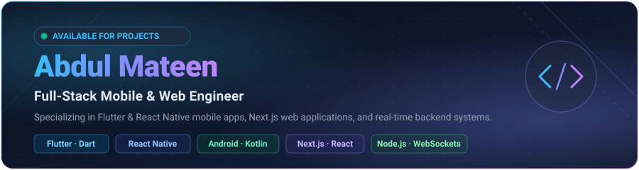

  

  

  
  &nbsp;
  
  &nbsp;
  
  &nbsp;
  

  
  
  
  

---

### 👨‍💻 About Me

I am an **AI Full-Stack Developer** and Software Engineer (**B.S. Computer Science**, COMSATS University Islamabad) with strong expertise across **AI-powered web platforms**, **cross-platform mobile apps**, **Electron desktop simulations**, and **Python-based system & IoT automation**.

- 💼 **Full-Stack Developer @ Esforge Pvt Limited** *(Oct 2024 – Present)*: Building **React Native** IoT mobile features, **Next.js** web applications, and **Electron.js** desktop simulations integrated with **MQTT / Mosquitto Broker** and **Python** hardware data pipelines.
- ⚙️ **Backend Developer @ BXTrack Solutions** *(Apr 2024 – Jun 2024)*: Engineered **Node.js** backend systems integrating **OpenAI Assistant** AI workflows and **Stripe Payments** infrastructure.
- 🤖 **AI & Automation Focus:** Designing intelligent applications powered by **OpenAI Assistants**, **AI-driven task automation**, and **Python** data scripting.
- 🚀 **Production Shipping:** Experienced delivering signed Google Play Store release builds (`.aab` / `.apk`), offline-first mobile architectures, and low-latency WebSocket engines.

---

### 🤝 Contributor & Organization Projects

| Project | Role / Organization | Tech Stack | Highlights |
| :--- | :--- | :--- | :--- |
| 🎮 **[Fruit Blast / Fluffy Merge](https://github.com/EsforgeUE5/fm)** | **Contributor** · Esforge / Auxo Studios | `Flutter` `Dart` `Audio Engine` `Particle FX` | Shipped production v1.0.2 with signed `.aab` & `.apk` Google Play releases. Engineered merge physics, custom effects, and progression loop. |
| 🖥️ **TSM (Desktop Simulation & IoT)** | **Full-Stack Engineer** · Esforge Pvt Limited | `Electron.js` `MQTT` `Mosquitto` `Python` `ESP` | Built a real-time desktop simulation platform receiving live telemetry from ESP IoT hardware via MQTT/Mosquitto and Python automation scripts. |

---

### 🚀 Latest Projects Showcase

| Project | Status / Platform | Tech Stack | Overview |
| :--- | :--- | :--- | :--- |
| 📱 **[SwapScroll](https://github.com/Matyyn/swapscroll)** | `Latest • Nov 2026` *Android 14+ / iOS* | `Flutter` `Dart` `Drift (SQLite)` `Riverpod` | Bespoke luxury item & fashion swapping platform featuring edge-to-edge atelier UI, fluid transitions, and local-first caching. |
| ⚡ **[StartNow](https://github.com/Matyyn/startnow)** | `Oct 2026` *Android Native* | `Kotlin` `Clean Architecture` `AI Step Generator` | Offline-first Android productivity app with AI-assisted step generation, Domain-Driven Clean Architecture, and Apple HIG transitions. |
| 📈 **[Arbitrage Tracker & App](https://github.com/Matyyn/Arbitrage_App)** • [Backend Engine](https://github.com/Matyyn/Arbitrage-Tracker-) | `Sept 2026` *Backend + Android* | `Node.js` `WebSockets` `Ethers.js` `Kotlin` | Low-latency CEX-to-DEX crypto arbitrage engine monitoring Binance WebSockets and Uniswap/PancakeSwap pools with Android client alerts. |
| 🛡️ **[SubGuard](https://github.com/Matyyn/SubGuard)** | `Aug 2026` *Cross-Platform* | `React Native` `Expo` `TypeScript` `Lucide Icons` | Modern mobile subscription tracker providing recurring expense analytics, renewal alerts, and spending insight visualizations. |
| 🔤 **[Word Game](https://github.com/Matyyn/word_game)** | `Oct 2026` *Android / iOS* | `Flutter` `Dart` `Android NDK 26.1` `Apple HIG` | Sleek word puzzle mobile game built with Android NDK integration, randomized level generation, and Apple HIG styling. |
| ✨ **[Beads Glimmer](https://github.com/Matyyn/beads-glimmer)** | `Oct 2026` *Mobile POS* | `Flutter` `Dart` `PDF Engine` `Offline Sync` | Boutique POS & inventory management mobile system featuring offline auto-sync, embedded logo PDF receipts, and release builds. |
| 🧠 **[MindCare Platform](https://github.com/Matyyn/mindcare-mobile)** • [Web Frontend](https://github.com/Matyyn/Mind-Care-Front-End) | *FYP* *Web + Mobile* | `React` `React Native` `Chakra UI` `Redux` `Zustand` | Digital Mental Health Assistance Platform built with React/Chakra UI (Redux Toolkit) and React Native mobile app (Zustand). |

---

### 🛠️ Tech Stack & Skills

  <b>🤖 AI, Automation & Languages:</b> 
  
  
  
  
  
  

  <b>🌐 Full-Stack Web & UI Systems:</b> 
  
  
  
  
  
  
  
  

  <b>📱 Mobile & Desktop Engineering:</b> 
  
  
  
  
  
  

  <b>⚙️ Backend, IoT, Payments & Web3:</b> 
  
  
  
  
  
  

  <b>🗄️ Databases, Hosting & Workflow:</b> 
  
  
  
  
  
  
  
  

---

### 📊 GitHub Activity & Stats

  
  &nbsp;
  

  

---

  <h3>🤝 Let's Connect & Build Together</h3>
  
Always open to AI Full-Stack roles, mobile/desktop engineering collaborations, and innovative product teams.

  
  &nbsp;
  
  &nbsp;
  

    
  

